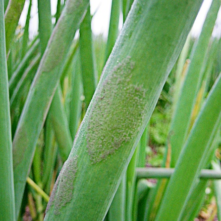
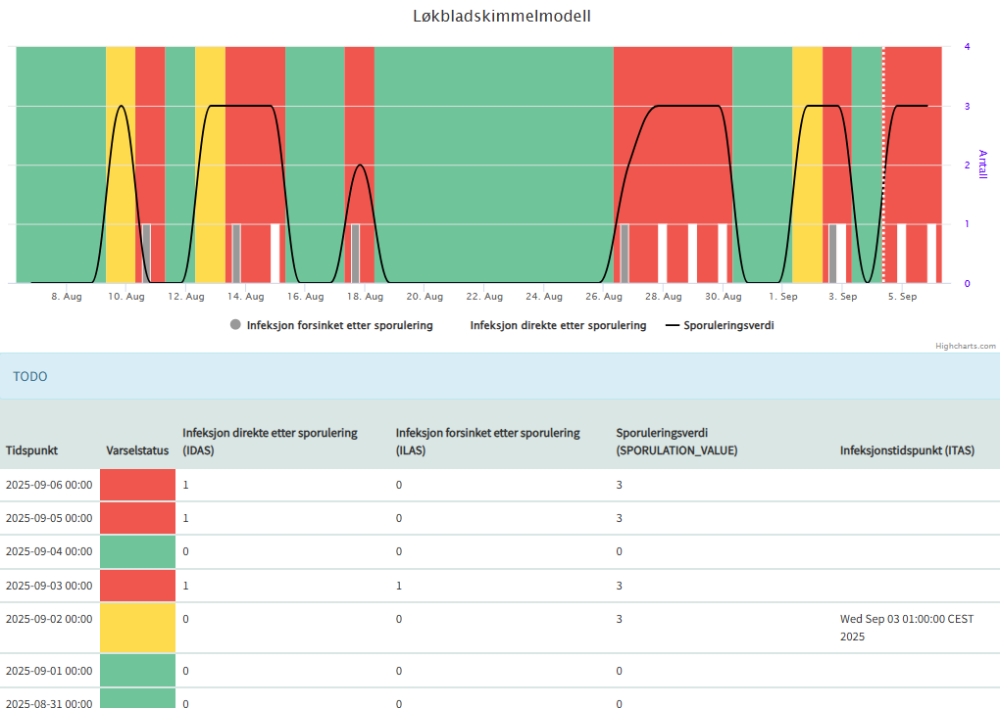

# Onion Downy Mildew – DeVisser’s Downcast 
This model calculates infection risk of onion downy mildew (*Peronospora destructor*) using weather data and forecasts. The model is of relevance to spring onion, bulb onion and other species within *Allium sp.*   

In Norway, main outbreaks of onion downy mildew usually appear in late summer (July/August), but not annually in all onion-producing regions. A spraying decision should therefore be based on an assessment of present inoculum, in addition to the issued risk alerts.  



*Onion downy mildew in spring onion. (Photo: Arne Hermansen, NIBIO)*

The DeVisser Downcast forecast model is based on the biology of onion downy mildew and its response to different weather conditions. Risk events are calculated based on hourly values of humidity, air temperature, leaf moisture and precipitation. In Norway, weather data is obtained from weather stations affiliated with the Agrometeorological service ([Landbruksmeteorologisk Tjeneste (LMT)](https://lmt.nibio.no/)) and from 2-day forecasts by the [Norwegian Meteorological Institute](https://met.no). 

The model calculates whether there are conditions for sporulation, infection and possibly failed infection.  

**Sporulation events** depend on high relative humidity (RH) at night (over 92%), provided no precipitation between 00:00 and 06:00 AM. When this occurs, a yellow risk alert is issued. Sporulation may occur at temperatures between 4 and 26 °C (optimally 12-20 °C). High temperatures will suppress sporulation, and risk alerts are not issued if temperatures the previous day were above 27 °C. A sporulation index of 1-3 is calculated based on the high RH and temperature duration, where an index of 3 indicates optimal sporulation conditions.  

**Infection events** depend on leaf wetness and can occur up to 3 days after sporulation. Such events will trigger a red risk alert. A direct infection requires at least 2 hours of leaf wetness the morning after sporulation (optimum temperature 6-16 °C). Alternatively, a delayed infection may occur up to 72 hours after sporulation, given at least 144 minutes of leaf wetness during a 3-hour period. It is assumed that all spores germinate simultaneously, thus only one infection event (red alert) can occur after a sporulation event.  

Short periods of leaf wetness (90-150 minutes during a 5-hour period) may cause the spores to germinate and die. Under these circumstances we have a failed infection, and the potential infection event is cancelled. A later infection event requires a new sporulation event. 

## Interpretation of warnings 

A sporulation event triggers a yellow alert (possible infection risk). A sporulation event followed by an infection event within 72 hours triggers a red alert (high infection risk) 

Model calculations are updated daily, based on observed weather data to present time and 2-day weather forecasts. 

Explanation of warning details:  

*Sporulation value* gives values from 0-3, where 3 indicates optimal conditions for sporulation. Values 1-3 issue a yellow alert.  

*Infection directly after sporulation (IDAS)* shows whether infection is expected the morning after sporulation. Red alert if IDAS = 1  

*Infection delayed after sporulation (ILAS)* shows whether infection is calculated within 3 days after sporulation (If IDAS = 0). Red alert if ILAS = 1.    

*Time of infection (ITAS)* indicates the estimated time of infection in the case of delayed infection.  



*Screenshot from detailed alert view for onion downy mildew risk alerts*

## Season of model operation (Norway)
Risk alerts are issued from a number of weather stations in areas with onion production. The model is active from June through September. 

## Test and validation of the model 
DeVisser’s DOWNCAST is a decision support model based on the American model DOWNCAST (Jesperson and Sutton, 1987) with further adaptations to fit Dutch conditions (DeVisser 1998). The model implemented in VIPS is based on the descriptions by DeVisser (1998). 

In Norway, the model is validated in field trials over five seasons (2005-2009), as part of the project *Effective and sustainable control strategies for downy mildews in onions, lettuce and cucumbers in Norway*. The trials were performed in spring onion fields in Vestfold County, where spore catch and different spray intervals were assessed to evaluate model performance. The results showed a good correlation between the estimated sporulation periods (yellow alerts) and capture in spore traps (85 % correct alerts). Spray intervals based on model alerts were assessed as follows: if more than 7 days since last treatment, VIPS is checked daily, and spraying is postponed until the next red risk alert is issued.  Model-based spray intervals were as effective as 7-day routine treatment with half as many treatments.  

## Recommendations for model use  

When risk alerts are issued, the potential need for treatments should be based on the infection pressure and timing of previous treatments. Contact your local agricultural advisor for details on treatment strategies such as relevant fungicides, spray timing and treatment intervals.  

## References 

de Visser, C.L.M. 1998. Development of a downy mildew advisory model based on downcast. European Journal of Plant Pathology 104: 933-943. 

Onion downy mildew description: [Plantevernleksikonet](https://www.plantevernleksikonet.no/l/oppslag/488/). (Norwegian only)

Contact person: [Berit Nordskog](https://nibio.no/en/employees/berit-nordskog) 


## Development

### Clone Gitlab repository

```
$ git clone https://gitlab.nibio.no/VIPS/models/java/Model_DOWNCASTMO.git
$ cd Model_DOWNCASTMO
```

### Compile, run tests
```bash
mvn clean install
```

### Deploy to VIPSCore
See [the VIPSCore README](https://gitlab.nibio.no/VIPS/VIPSCore)